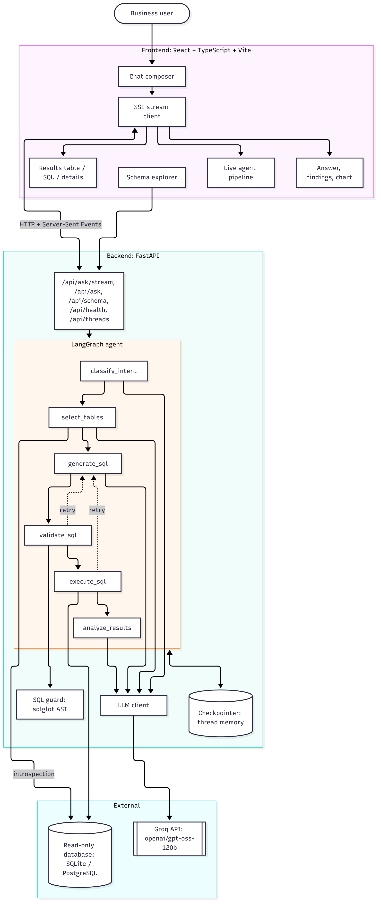
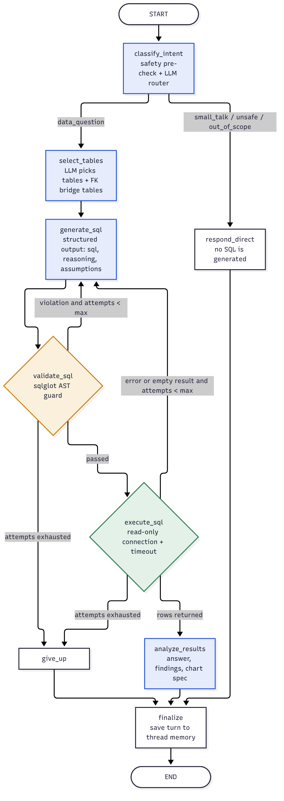
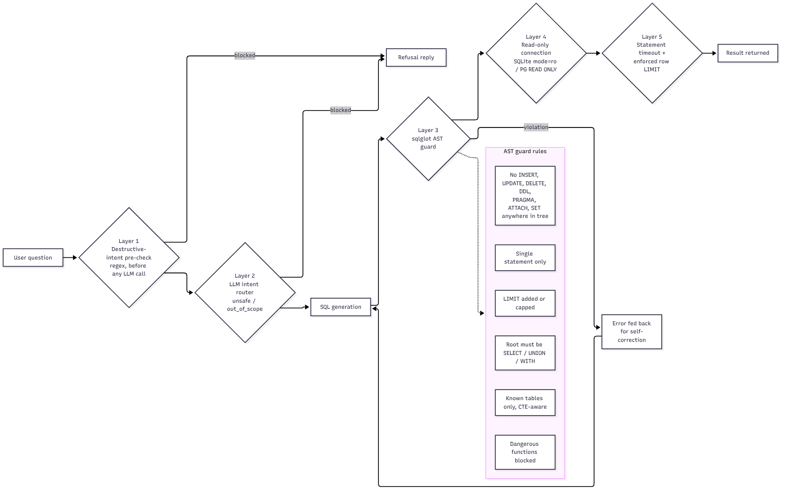
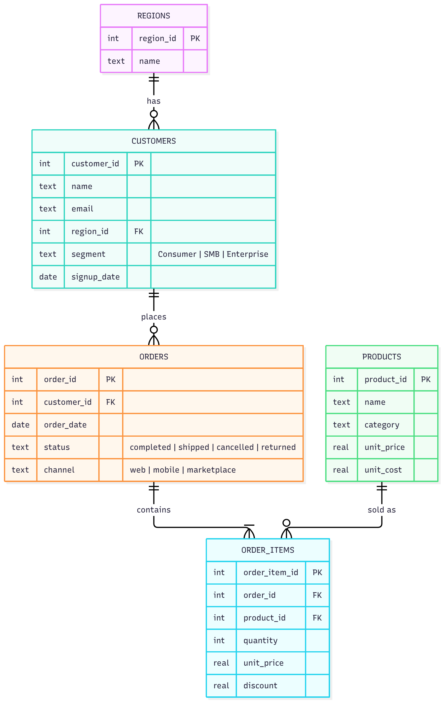
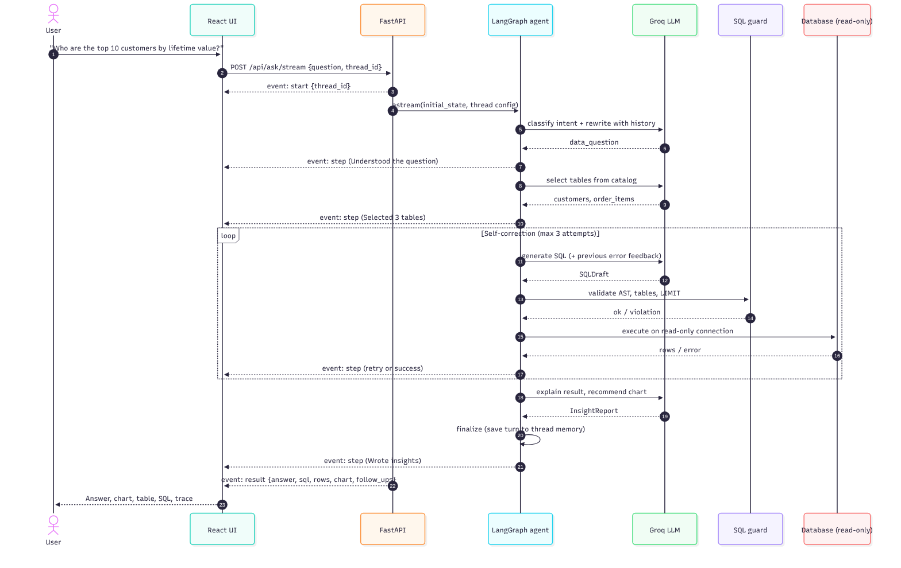
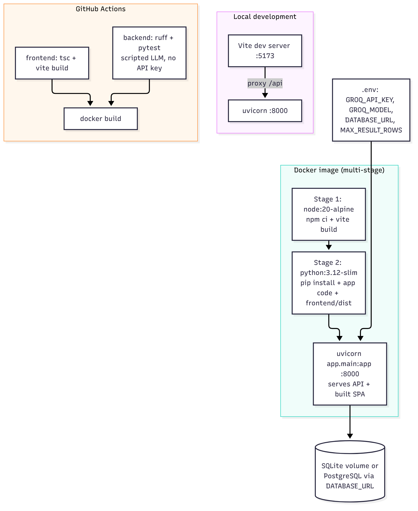

# InsightGraph — System Design

## 1. Architecture overview



InsightGraph has three tiers:

| Tier | Responsibility | Main modules |
|------|----------------|--------------|
| **Frontend** | Chat UI, live pipeline, charts, tables, schema explorer | `frontend/src/App.tsx`, `components/*`, `api.ts` |
| **Backend API** | HTTP + SSE endpoints, request validation, static hosting of the built SPA | `backend/app/main.py`, `backend/app/api/routes.py` |
| **Agent** | LangGraph state machine that turns a question into a verified answer | `backend/app/agent/*`, `backend/app/services/*`, `backend/app/db/*` |

External dependencies are the LLM provider (Groq) and the analytical database (SQLite by default, PostgreSQL supported through `DATABASE_URL`).

## 2. LangGraph agent

### 2.1 Graph



The graph is compiled in `app/agent/graph.py`. The diagram above is the design view. [`diagrams/langgraph-generated.mmd`](diagrams/langgraph-generated.mmd) is the Mermaid export produced by LangGraph itself (`graph.get_graph().draw_mermaid()`), so it always matches the code.

### 2.2 Nodes

| Node | Type | Input | Output | LLM schema |
|------|------|-------|--------|------------|
| `classify_intent` | Router | question, history | intent, standalone question | `IntentDecision` |
| `select_tables` | Retrieval | standalone question, table catalog | selected tables (+ FK bridge tables), schema context | `TableSelection` |
| `generate_sql` | Generator | schema context, business rules, history, previous error | SQL, reasoning, assumptions | `SQLDraft` |
| `validate_sql` | Guard (deterministic) | SQL | normalised SQL with LIMIT, or violation | — |
| `execute_sql` | Tool (deterministic) | SQL | columns, rows, timing, or error / empty-result signal | — |
| `analyze_results` | Analyst | question, SQL, result preview | answer, findings, chart spec, follow-ups | `InsightReport` |
| `respond_direct` | Responder (deterministic) | intent | refusal / greeting / scope message | — |
| `give_up` | Terminal (deterministic) | attempt log | failure explanation | — |
| `finalize` | Memory | full state | appends the turn to `history` (last 5 turns) | — |

### 2.3 Conditional edges

| From | Condition | To |
|------|-----------|----|
| `classify_intent` | `intent == data_question` | `select_tables` |
| `classify_intent` | otherwise | `respond_direct` |
| `validate_sql` | no error | `execute_sql` |
| `validate_sql` | error and `attempts < MAX_SQL_ATTEMPTS` | `generate_sql` |
| `validate_sql` | error and attempts exhausted | `give_up` |
| `execute_sql` | rows returned (or empty after one retry) | `analyze_results` |
| `execute_sql` | error / first empty result and `attempts < MAX` | `generate_sql` |
| `execute_sql` | attempts exhausted | `give_up` |

### 2.4 State

`AgentState` (`app/agent/state.py`) is a `TypedDict`. Every turn starts from `initial_state(question)`, which resets all per-turn fields. `history` is **not** reset, so the checkpointer keeps the thread's conversation memory.

| Group | Fields |
|-------|--------|
| Routing | `question`, `standalone_question`, `intent`, `intent_reason` |
| Schema | `selected_tables`, `table_reason`, `schema_context` |
| Self-correction | `sql`, `sql_reasoning`, `assumptions`, `attempts`, `last_error`, `error_stage`, `empty_retried`, `attempt_log` |
| Execution | `columns`, `rows`, `row_count`, `limit_applied`, `exec_ms` |
| Output | `answer`, `key_findings`, `chart`, `follow_ups`, `status` |
| Streaming | `last_step` (title/detail/status of the node that just ran) |
| Memory | `history` (question, SQL, short answer per turn) |

### 2.5 Self-correction loop

1. `generate_sql` increments `attempts` and, when `last_error` is set, adds the failed SQL and the exact error to the prompt.
2. Failures come from three sources: guard violations (`validation`), database errors such as unknown columns (`execution`), and the first empty result (`empty_result`), which usually means a wrong filter value.
3. Each failure is appended to `attempt_log` and streamed to the UI as an amber retry step.
4. After `MAX_SQL_ATTEMPTS` (default 3) the graph routes to `give_up` instead of looping forever. The `recursion_limit` is also set to 40 as a hard backstop.

### 2.6 Conversation memory

- The graph is compiled with a LangGraph checkpointer (`InMemorySaver`) and every request carries `configurable.thread_id`.
- `finalize` stores up to 5 recent turns in `history`. The intent router and SQL generator both receive this history, so "now only for Europe" is rewritten as a standalone question before SQL is written.
- Threads are fully isolated (covered by `test_threads_are_isolated`). The checkpointer can be swapped for `SqliteSaver` or `PostgresSaver` without changing any node code.

### 2.7 Schema selection and join bridging

The table catalog is built from live SQLAlchemy introspection (`get_schema`). It includes column types, primary keys, foreign keys, row counts and two sample rows per table. The LLM chooses the tables it needs. `AnalystNodes._connect_tables` then runs a breadth-first search over the foreign-key graph and adds any bridge tables needed to join them. For example, `regions` + `order_items` automatically pulls in `customers` and `orders`. Only the selected tables are rendered into the SQL prompt, which keeps the prompt small on larger schemas.

## 3. Safety design



| Layer | Where | What it stops |
|-------|-------|---------------|
| 1. Destructive-intent pre-check | `sql_guard.looks_destructive` | "Delete all cancelled orders" is refused **before** any LLM call |
| 2. LLM intent router | `classify_intent` | Bulk data exfiltration, rule-bypass attempts, out-of-scope requests |
| 3. AST guard | `sql_guard.validate_sql` (sqlglot) | Non-SELECT roots, multiple statements, DML/DDL nested in CTEs, `PRAGMA`/`ATTACH`/`SET`, unknown tables, dangerous functions (`load_extension`, `pg_sleep`, …) |
| 4. Read-only connection | `database.build_engine` / `execute_readonly` | SQLite opened with `mode=ro`; PostgreSQL transactions set to `READ ONLY` and rolled back |
| 5. Resource limits | `execute_readonly`, guard | Statement timeout (`QUERY_TIMEOUT_SECONDS`), enforced `LIMIT` (`MAX_RESULT_ROWS`) |

Layers 3–5 do not depend on the LLM behaving correctly.

## 4. API design

| Method | Path | Description |
|--------|------|-------------|
| `GET` | `/api/health` | Status, LLM provider/model readiness, database dialect and table count |
| `GET` | `/api/schema` | Tables with columns, PK/FK flags and row counts |
| `GET` | `/api/examples` | Suggested questions |
| `POST` | `/api/ask` | Runs the agent and returns the full `AskResponse` JSON |
| `POST` | `/api/ask/stream` | Same, streamed as Server-Sent Events |
| `GET` | `/api/threads/{thread_id}` | Conversation memory of a thread |

### SSE event contract (`/api/ask/stream`)

| Event | Payload |
|-------|---------|
| `start` | `{thread_id, question}` |
| `step` | `{node, title, detail, status: done/retry/blocked/error, data, t_ms}`, one per node execution |
| `result` | Full `AskResponse` (answer, SQL, columns, rows, chart, follow-ups, attempts, timings) |
| `error` | `{message}`, for example when the LLM provider is unreachable |

Request body for both ask endpoints:

```json
{ "question": "What is total revenue by region?", "thread_id": "optional-thread-id" }
```

## 5. Data model



The seeded database (`app/db/seed.py`, fixed random seed) contains 5 regions, 650 customers, 60 products in 6 categories, 5,200 orders and about 9,300 order lines covering 2025-01-01 to 2026-10-31. It includes realistic signals: regional growth rates, year-end seasonality, segment-specific buying patterns, discounts and order statuses.

Business definitions such as revenue, gross profit and AOV are configured centrally in `Settings.business_rules` and injected into the SQL prompt, so every answer uses the same metric definitions.

## 6. Request lifecycle



## 7. LLM layer

`app/agent/llm.py` defines an `LLMClient` protocol with a single method, `structured(task, messages, schema)`, which always returns a validated Pydantic object.

- **`GroqLLM`** wraps `langchain_groq.ChatGroq` with `with_structured_output(schema)`. Runnables are cached per schema. Errors are converted to `LLMError` and surfaced as an SSE `error` event.
- **`ScriptedLLM`** replays predefined responses per task or per question. The test suite and golden scenarios use it, which makes CI deterministic and keyless.

Model, temperature and timeout are configured through environment variables. The default model is `openai/gpt-oss-120b` with low reasoning effort (fast and accurate for SQL); `llama-3.3-70b-versatile` and other Groq models with tool calling also work.

## 8. Configuration

| Variable | Default | Purpose |
|----------|---------|---------|
| `LLM_PROVIDER` | `groq` | `groq` or `scripted` |
| `GROQ_API_KEY` | — | Groq API key |
| `GROQ_MODEL` | `openai/gpt-oss-120b` | Model id |
| `LLM_REASONING_EFFORT` | `low` | Reasoning effort for gpt-oss models |
| `DATABASE_URL` | `sqlite:///backend/data/insightgraph.db` | Any SQLAlchemy URL |
| `MAX_SQL_ATTEMPTS` | `3` | Self-correction budget |
| `MAX_RESULT_ROWS` | `500` | Enforced row limit |
| `QUERY_TIMEOUT_SECONDS` | `10` | Statement timeout |
| `HISTORY_TURNS` | `5` | Turns kept in thread memory |
| `CORS_ORIGINS` | `http://localhost:5173,...` | Allowed browser origins |

## 9. Deployment



- **Docker:** a multi-stage `Dockerfile` builds the React app with Node, then copies `frontend/dist` into a slim Python image. FastAPI serves the API and the SPA on port 8000.
- **Docker Compose:** a single service, a named volume for the SQLite file and an `.env` file for secrets.
- **CI:** GitHub Actions runs ruff and pytest for the backend, a type-check and build for the frontend, and a Docker build.

## 10. Scalability and extension points

| Need | Change |
|------|--------|
| Persistent memory across restarts | Swap `InMemorySaver` for `SqliteSaver` / `PostgresSaver` in `build_graph` |
| Large schemas (hundreds of tables) | Replace the catalog prompt in `select_tables` with embedding retrieval over table descriptions |
| Another LLM provider | Implement `LLMClient.structured` (e.g. `ChatOpenAI`) and register it in `get_llm` |
| Human approval for expensive queries | Add a LangGraph `interrupt` before `execute_sql` |
| Horizontal scaling | Stateless API workers plus a shared Postgres checkpointer |
