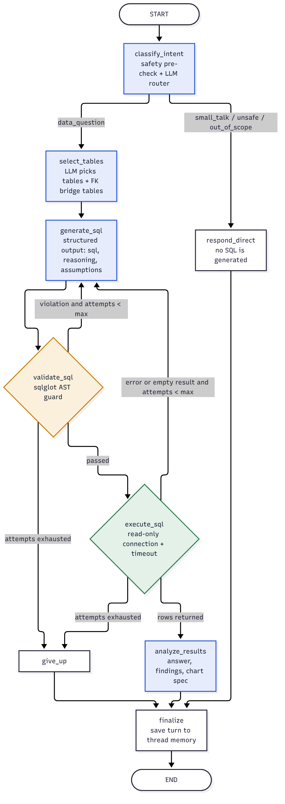

# Module Report 06 — LangGraph Agent

**Files:** `backend/app/agent/state.py`, `backend/app/agent/nodes.py`, `backend/app/agent/graph.py`
**Depends on:** LangGraph 1.x, the LLM layer (report 05), the database layer (02), the SQL guard (04), the chart service (07)
**Used by:** API layer (`/api/ask`, `/api/ask/stream`, `/api/threads`)

## 1. Purpose

This is the core of InsightGraph: a stateful agent that turns a plain-English question into a verified SQL answer by working through explicit steps, checking its own work and remembering the conversation.



## 2. How it works

### 2.1 State (`state.py`)

`AgentState` is a `TypedDict` passed between nodes. Each node returns only the keys it changes, and LangGraph merges the update.

| Group | Keys |
|-------|------|
| Routing | `question`, `standalone_question`, `intent`, `intent_reason` |
| Schema | `selected_tables`, `table_reason`, `schema_context` |
| Self-correction | `sql`, `sql_reasoning`, `assumptions`, `attempts`, `last_error`, `error_stage`, `empty_retried`, `attempt_log` |
| Execution | `columns`, `rows`, `row_count`, `limit_applied`, `exec_ms` |
| Output | `answer`, `key_findings`, `chart`, `follow_ups`, `status` |
| Streaming | `last_step`: a human-readable description of what the node just did |
| Memory | `history` |

`initial_state(question)` resets every per-turn key but deliberately leaves out `history`, so the checkpointer keeps the thread's memory between turns.

### 2.2 Nodes (`nodes.py`)

Nodes are methods of `AnalystNodes(llm, engine, settings)`. Dependencies are injected, so tests pass in a scripted LLM and a test database.

| # | Node | What it does |
|---|------|--------------|
| 1 | `classify_intent` | Runs the deterministic destructive check; if clean, calls the LLM for intent and a standalone rewrite of follow-ups using the last 5 turns |
| 2 | `select_tables` | The LLM picks tables from the catalog; unknown names are dropped (falling back to all tables if none remain); a **breadth-first search over foreign keys** adds bridge tables (e.g. `regions` + `order_items` → also `customers`, `orders`); renders the schema context for only those tables |
| 3 | `generate_sql` | Increments `attempts`; when `last_error` is set, adds the failed SQL and the exact error to the prompt; returns SQL, reasoning and assumptions |
| 4 | `validate_sql` | Runs the AST guard. On a violation it records an `attempt_log` entry (stage `validation`) and sets `last_error` |
| 5 | `execute_sql` | Runs on the read-only connection. On an error: stage `execution`. If the **first** result is empty and attempts remain: stage `empty_result` with a hint to check filter values. Otherwise stores rows and timing |
| 6 | `analyze_results` | No rows: deterministic "no matching data" answer. Otherwise the LLM writes the answer, findings, chart and follow-ups from up to 60 rows; the chart is checked by the chart service |
| 7 | `respond_direct` | Fixed replies for unsafe, out-of-scope and small-talk messages, plus suggested questions |
| 8 | `give_up` | After the attempt budget is used, explains the last error and how to rephrase |
| 9 | `finalize` | Appends `{question, sql, answer}` to `history` and keeps the last 5 turns |

### 2.3 Edges (`graph.py`)

```
START → classify_intent
classify_intent ─data_question→ select_tables → generate_sql → validate_sql
classify_intent ─otherwise→ respond_direct
validate_sql ─ok→ execute_sql | ─error & attempts<max→ generate_sql | ─exhausted→ give_up
execute_sql  ─ok→ analyze_results | ─error/first-empty & attempts<max→ generate_sql | ─exhausted→ give_up
analyze_results, respond_direct, give_up → finalize → END
```

The graph is compiled with an `InMemorySaver` checkpointer. Every call passes `configurable.thread_id`, which isolates conversations. `recursion_limit=40` is a hard backstop on top of the attempt budget.

### 2.4 Worked example: self-correction

Question: *"Who are the top 10 customers by lifetime value?"*

1. `generate_sql` (attempt 1) writes `SELECT c.customer_name …`
2. `validate_sql` passes, because the syntax is valid and the tables are known.
3. `execute_sql` fails with `no such column: c.customer_name`, which is logged as stage `execution`.
4. `generate_sql` (attempt 2) sees the error, uses `c.name` and adds segment and region.
5. The query validates and returns 10 rows; `analyze_results` writes the answer and a bar chart.

The UI shows "Self-corrected 1 time" and lists the error under "How it was built".

The same loop was observed during live testing with Groq. For "What share of orders comes from each sales channel?", the first query failed with `near "to": syntax error`. The agent rewrote it and answered correctly 0.8 s later (see `docs/screenshots/03-self-correction-trace.png`).

## 3. How it was built

| Decision | Alternatives | Why |
|----------|--------------|-----|
| Explicit LangGraph state machine | A ReAct agent with a SQL tool | The steps are known in advance. An explicit graph is predictable, testable node by node, and the safety step can never be skipped. |
| Deterministic nodes for validate, execute, reply and give-up | Letting the LLM decide | Safety and control flow should not depend on model behaviour |
| An attempt budget plus a retry on the first empty result | Unlimited retries | Bounded cost and latency. An empty result usually means a wrong filter (case or date), which one retry fixes |
| FK path search for joins | Asking the LLM to list every join table | The model tends to miss bridge tables. The graph search is exact and free. |
| `last_step` in state | A separate event bus | Each node describes its own work; the API streams it directly |
| History kept out of `initial_state` | Rebuilding the history on every request | The checkpointer owns memory; turns stay cheap and threads isolated |
| Dependency-injected `AnalystNodes` | Module-level globals | Tests build the real graph with a scripted LLM and a temporary database |

## 4. Test cases

### 4.1 Graph behaviour: `backend/tests/test_graph.py`

| ID | Test | Scenario | Expected | Result |
|----|------|----------|----------|--------|
| AG-01 | `test_happy_path_answers_with_rows_and_chart` | Revenue by region | Exact node order, 5 rows sorted descending, bar chart, 1 attempt, `LIMIT 500`, bridge tables added, 4 LLM calls | ✅ Pass |
| AG-02 | `test_self_corrects_after_execution_error` | First SQL uses a missing column | Attempts = 2, `generate_sql` runs twice, log stage `execution` with "no such column" | ✅ Pass |
| AG-03 | `test_self_corrects_after_safety_violation` | First SQL is `DELETE` | Log stage `validation`; the corrected query answers | ✅ Pass |
| AG-04 | `test_retries_once_on_empty_result` | Filter `'Completed'` (wrong case) | Log stage `empty_result`; second query returns a count; KPI chart | ✅ Pass |
| AG-05 | `test_gives_up_after_max_attempts` | Every attempt fails | status `failed`, `give_up` reached after 3 attempts, explanation returned | ✅ Pass |
| AG-06 | `test_destructive_request_blocked_without_calling_llm` | "Delete all cancelled orders" | status `refused`, path classify → respond → finalize, **zero LLM calls** | ✅ Pass |
| AG-07 | `test_llm_classified_unsafe_request_is_refused` | Bulk email export | Refused, `execute_sql` never runs | ✅ Pass |
| AG-08 | `test_small_talk_does_not_query` | "hello!" | status `chat`, no SQL, suggestions returned | ✅ Pass |
| AG-09 | `test_follow_up_uses_conversation_memory` | Region revenue, then "now only Europe" | Standalone rewrite, 1 Europe row, history = 2 | ✅ Pass |
| AG-10 | `test_threads_are_isolated` | Questions in threads A and B | Thread B history = 1 | ✅ Pass |
| AG-11 | `test_graph_mermaid_contains_all_nodes` | Export the compiled graph | All nodes present in the Mermaid output | ✅ Pass |

### 4.2 Golden business scenarios: `backend/tests/test_scenarios.py`

Seven realistic questions run through the full graph against the real sample database using `tests/fixtures/analyst_scenarios.json`.

| ID | Question | Expected rows / chart | Result |
|----|----------|-----------------------|--------|
| AG-12 | What is total revenue by region? | 5 / bar | ✅ Pass |
| AG-13 | Show monthly revenue for 2026 as a trend | 10 / line | ✅ Pass |
| AG-14 | Who are the top 10 customers by lifetime value? | 10 / bar | ✅ Pass |
| AG-15 | What share of orders comes from each sales channel? | 3 / pie | ✅ Pass |
| AG-16 | Compare Q3 2026 revenue with Q3 2025 by region | 5 / bar (2 series) | ✅ Pass |
| AG-17 | What is the average order value by customer segment? | 3 / bar | ✅ Pass |
| AG-18 | Which product categories have the highest gross margin? | 6 / bar | ✅ Pass |
| AG-19 | `test_top_customers_scenario_self_corrects` | Attempts = 2, error mentions `customer_name` | ✅ Pass |
| AG-20 | `test_follow_up_scenario` | "Now only for Europe" → Europe row, KPI chart, history = 2 | ✅ Pass |
| AG-21 | `test_all_fixture_scenarios_are_covered` | Every fixture scenario has a test | ✅ Pass |

Every scenario also checks that the chart's `x` and `y` are real result columns.

**Result: 21 / 21 passed.**

## 5. Limitations and next steps

- `InMemorySaver` loses memory when the process restarts. `SqliteSaver` or `PostgresSaver` is a one-line swap.
- Table selection sends the whole catalog. For hundreds of tables, retrieval over embeddings would replace it.
- A LangGraph `interrupt` before `execute_sql` could add human approval for expensive queries.
